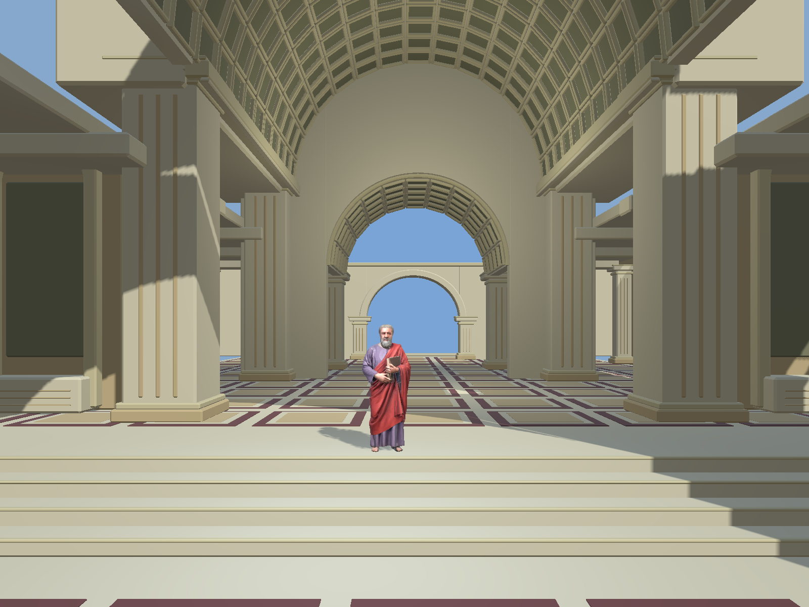
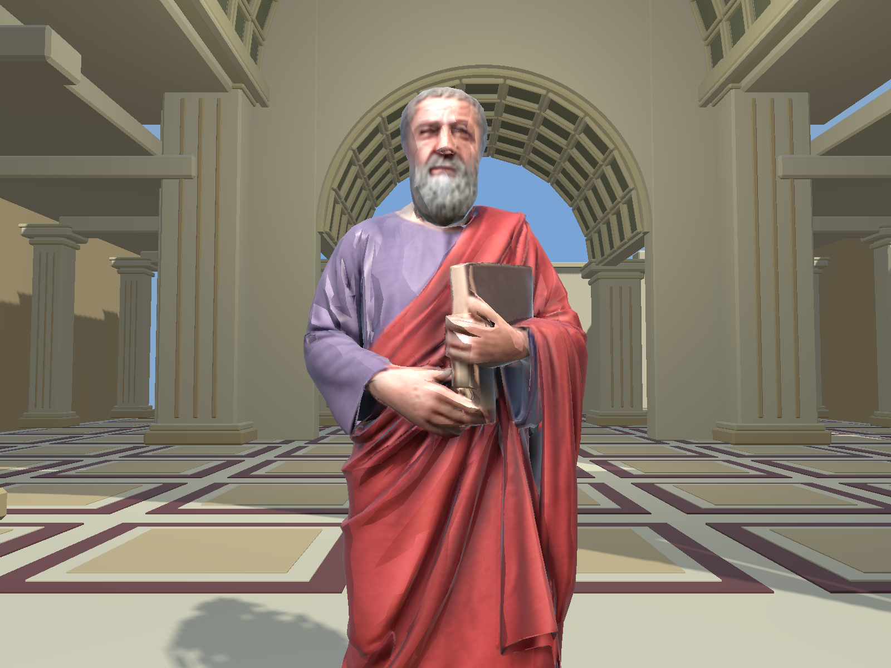
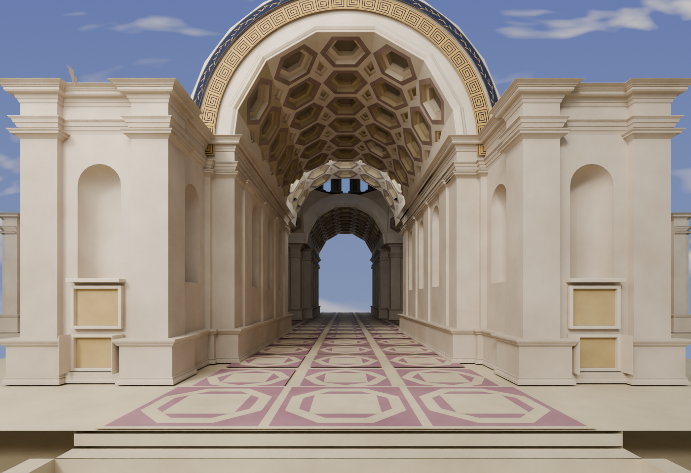
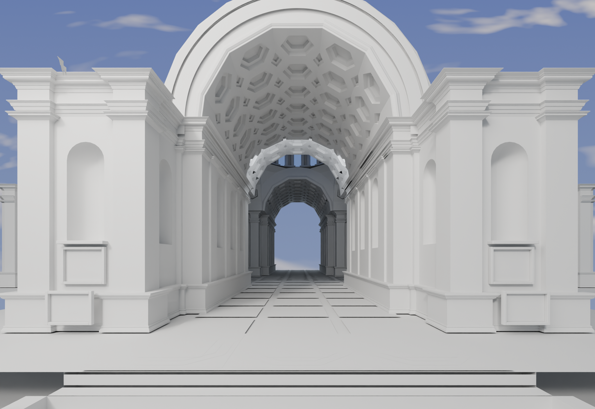
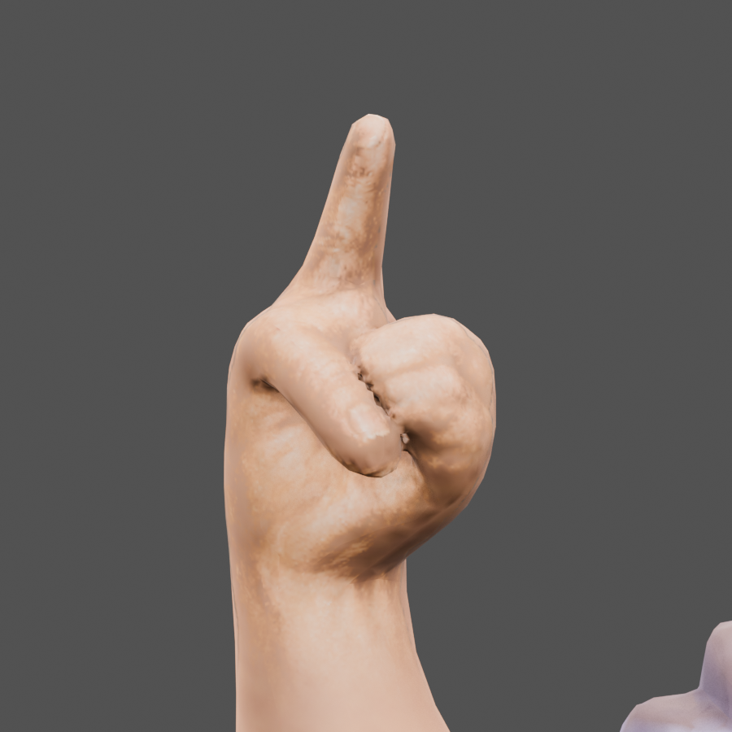
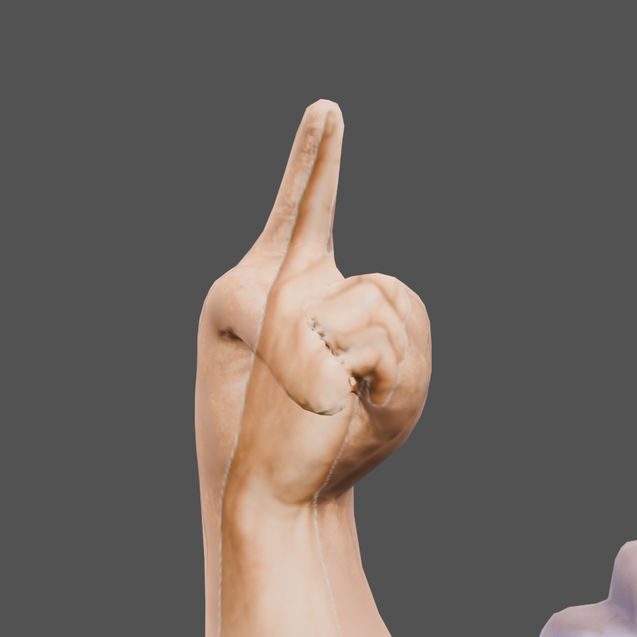

# 《The Living School of Athens》项目过程与成果报告

## 项目目标与现状

探索将拉斐尔《雅典学院》的中央建筑与人物转化为可观察的三维空间。仓库包含两个彼此独立的阶段：Unity 中央建筑与单人技术样板，以及后续 Blender 建筑上色与柏拉图资产研究。项目目前为未完成的阶段成果，不是完整壁画复现或完成的 AI 对话应用。

## 1. Unity 技术样板

仓库已有的 P0 样板实现了中央建筑灰盒、一名柏拉图诊断模型和有限范围内的行走。该人物源资产来自 Aholo Lux3D（任务 4277623），后续进行了坐标、材质和导出整理；不应将其称为完成的人物精修。原记录载明最终构建后的实体窗口复查未完成，漫游边界和完整场景美术也未验收。[查看 P0 验收与限制](../../qa/integration/P0_ACCEPTANCE.md)。

## 2. Blender 建筑上色

独立 Blender 场景在已有建筑基础上进行了墙柱、拱顶、地面、蓝金装饰和天空的材质处理，并调整下层浮雕框。下图是框体调整后的实际渲染；场景中没有完成群像、壁龛雕像或浮雕人物。建筑深部在非主视角仍有接缝，最终色调和修正未通过用户视觉验收。

下图为相同几何与相机的中性材质对照，生成时间早于下层框体调整，不能作为当前几何状态的精确对照。

## 3. 柏拉图局部迭代

V4 至 V5 对举手局部增加浅沟槽及贴图细节，以改善指向手势的可读性；这不是完整手部重建，手指仍非独立几何。V5 为独立角色，尚未与上述 Blender 建筑合成，也没有经过游戏引擎、绑定或动画验证。

| V4 举手 | V5 举手 |
| --- | --- |
|  |  |

## 本地查看及验证边界

按 [仓库首页](../../README.md) 下载并用 Blender 打开建筑或人物文件。2026-11-19 使用 Blender 4.5.15 后台读取两份源文件，并检查未打包的文件型图片：两者均无未打包图片；建筑文件提示由更新的 Blender 版本写入。此检查不等于完整交互、画面或兼容性验收。Unity 历史检查只适用于当时的独立样板，不代表 Blender 场景通过 Unity 测试。

原画及背景资料：[梵蒂冈博物馆作品介绍](https://www.museivaticani.va/content/musei/en/collezioni/musei/stanze-di-raffaello/stanza-della-segnatura/scuola-di-atene.html)；生成参考图仅用于辅助构思，遮挡部分存在推测。