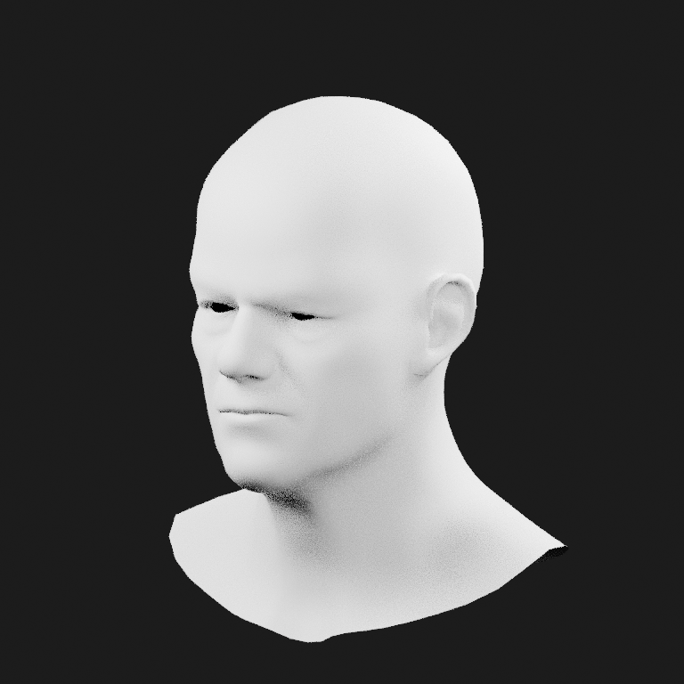

# Einar 原始基础头：独立灰模年龄评审

2026-10-23。**完成一次实际灰模渲染和独立源隔离；B 自审认为这份 raw `.base` 的老年大形仍不足，`art_not_accepted`。** 不把它等同于带置换、表情、材质和发须的 Einar 最终角色效果。结果已发负责人，等待视觉复核。

- 输入仅 `DATA_GEO-einar_head.base` 的普通 Python 顶点／面数组及多边形平滑标记。4596 顶点、4522 多边形；无坐标／拓扑变形、UV、原材质、Shape Keys、眼球、毛发、绑定或置换。
- 复制数组后 `factory reset/use_empty`，断言来源 Mesh／Object／Armature／Action／Lattice／Text／Image／NodeGroup／Library／Keys 均已清除，才创建全新头、相机和三盏灯。新 Mesh 的 animation_data、shape_keys、modifiers 均为空。
- 顶点坐标、顶点／面顺序与平滑标记哈希前后一致：`24551fbdb188f994fcd6181b1959a310181ddf296356498cfb502892626e3fc9`。未保留来源材质、UV、自定义属性或动画。
- 唯一实际图 768×768、三分之四、Cycles CPU 4 线程、16 samples、不降噪；独立源在渲染前保存，来源／许可／改动记录内嵌为 Scene 属性。
- 成功进程 **9.704 秒／峰值 504.7 MiB／退出 0**，低于 45 秒和 1.2 GiB。源文件 SHA256／字节／只读保持，未终止其他进程。
- 首个尝试在提取前因过严断言退出：错误地要求来源 `animation_data` 容器为 None，实际容器存在但 drivers 为 0。未产生图或保存 `.blend`。失败日志保留为 `stage2.*`，修正为检查来源 driver=0 后的成功运行记录为 `stage2r1.*`；新 Mesh 仍要求 animation_data=None。共两个进程、一次实际渲染，没有重出图。

B 直接看图：五官及头颈结构可辨，但口周、颊颌和颏颈较紧致，缺少目标老人组织的松垂；高光偏亮且无眼球，局部细微表面变化不能据此定论。当前证据支持“raw base 能独立隔离”，不支持“无发老人形体已通过”。不继续参数变形、加胡须或自动启动其他基础模型路线。

独立检查员已实际查看同一张图，结论一致：面颊／口周平顺紧实、下颌线及颏颈转折清晰，未呈现可信的老人年龄大形；亮部与缺眼球限制局部判断。该结论仅针对本 raw base。

交付：

- `art/characters/plato/v002/einar-base-review/einar-raw-base-gray.blend`（732353 字节）
- 同目录 `raw-head-geometry.json`（406260 字节，可回退到未改动原始几何）
- 本目录 `einar-raw-base-quarter.png`、`stage2-clean-base.json`、`stage2-run.json`、`stage2r1-run.json` 与两次 stdout/stderr。

来源：[Blender Studio Einar v1](https://studio.blender.org/characters/einar/v1/)，[CC BY 4.0](https://creativecommons.org/licenses/by/4.0/)。署名：**Einar Rig (CC-BY) Blender Foundation | studio.blender.org**。改动仅隔离原始几何、纯灰材质和审查场景。包内额外署名内容仍未读取。
