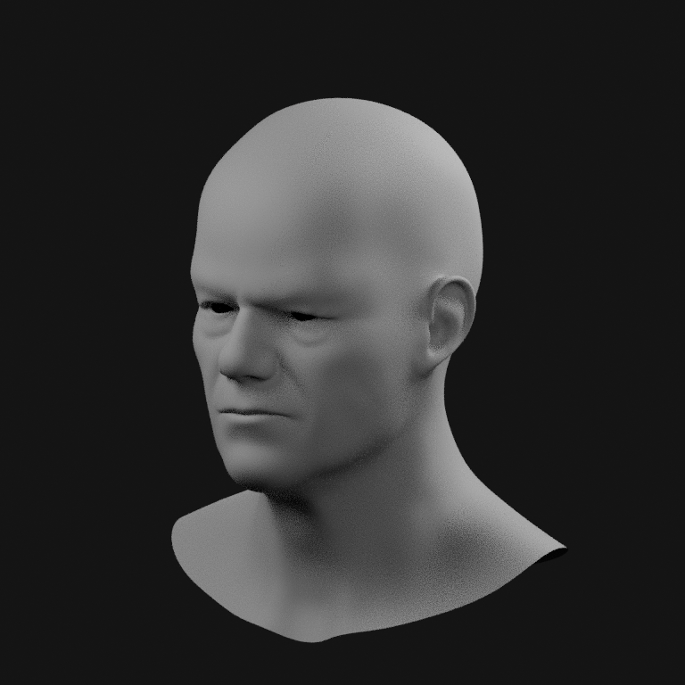
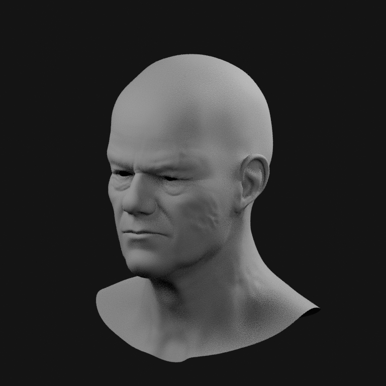

# Einar 默认雕刻原参数恢复：A/B

2026-10-23。**已恢复来源默认雕刻层，实际 A/B 可见年龄变化；是否达到柏拉图目标仍待负责人视觉验收。** 恢复依据来自原艺术家参数，没有调强度求效果。

| A：仅源 Catmull-Clark 2 | B：同细分＋真实默认位移 |
| --- | --- |
|  |  |

- 仅载 `DATA_GEO-einar_head.base`，复制普通顶点／面、`UVMap` 角点、实际存在的 `crease_edge` 及 sharp 标记。原始几何与 UV 复制哈希一致；factory reset 清空来源 ID 后才创建、求值干净头。
- A/B 同 Catmull-Clark L2、UV `PRESERVE_BOUNDARIES`、boundary `ALL`、use_creases／use_limit_surface。唯一差别是 B 启用重建的原九节点 Geometry Nodes：默认 Y 图，Midlevel=.5、Scale=.00800000038、Linear／REPEAT、法线缩放及 CORNER 捕获。无来源 Objects／rig／driver／Text／表情层／毛发／眼球或身体。
- 两张同 768²、16 samples、CPU 4 线程、AgX／exposure 0、灰色 .24、灯光 8／2／6W。仅两张实际渲染，未重出图，未覆盖此前 raw 图。
- A/B 求值拓扑均为 **72666 顶点／72352 四边面／144704 三角形**，面索引一致。B 相对 A 实测最大位移 `0.002765604488`、RMS `0.000451266328` 源坐标单位，72648 顶点位移大于 1e-8；包围盒亦变化。若以米制换算，约 max 2.766mm／RMS .451mm。技术变化不等于年龄通过。
- 单进程 **16.173 秒／峰值 649.97 MiB／exit 0**，低于 45 秒／1.2 GiB；源 `.blend` 哈希／字节／只读保持，未终止其他进程。
- 默认 EXR 已逐字节复制至衍生目录，SHA256 `782488ea8f9107c41a93465a0dcdf31894ce18885cc65c0e2e88241a7d6fe116`。只解码这一张默认图。独立 `.blend` 使用 `//textures/disp_default.exr`，不依赖 root 缓存；可编辑 Mesh＋Subsurf＋Geometry Nodes，B 状态保存。署名／许可／实际改动内嵌 Scene 属性并附 `SOURCE.md`。

B 已实际看两图：B 的眉间／额纹、眼下袋状起伏、鼻唇沟、颊部与颈部皱褶明显增加，原艺术家默认层带来真实可见的年龄信息。下颌仍较硬朗，细分 L2／16 samples 与缺眼球限制部分细节判断；是否足够支撑柏拉图目标交负责人和独立审查，当前 `art_not_accepted`，不自动追加渲染或变形。

独立检查员亦已实际查看 A/B：认可可见改善，但否决其达到柏拉图老人头目标；认为下颌和口周仍紧实、颈部偏筋线，较像饱经风霜的成年／中年男性，颊部部分起伏偏刻痕。结论仅针对本组默认状态对照，不扩大为完整 Einar 失败。负责人最终视觉判定待回。

交付源：`art/characters/plato/v002/einar-default-sculpt-review/einar-default-sculpt-AB.blend`（964185 字节）；同目录 `textures/disp_default.exr`（3351552 字节）及 `SOURCE.md`。数值／路径／纹理哈希见 `stage5-default-sculpt-ab.json`，资源／源保护见 `stage5-run.json`；stdout／stderr 保留。独立源保存后未另行重开，Unity 未验证。

来源：[Einar v1](https://studio.blender.org/characters/einar/v1/)，署名 **Einar Rig (CC-BY) Blender Foundation | studio.blender.org**，[CC BY 4.0](https://creativecommons.org/licenses/by/4.0/)。
