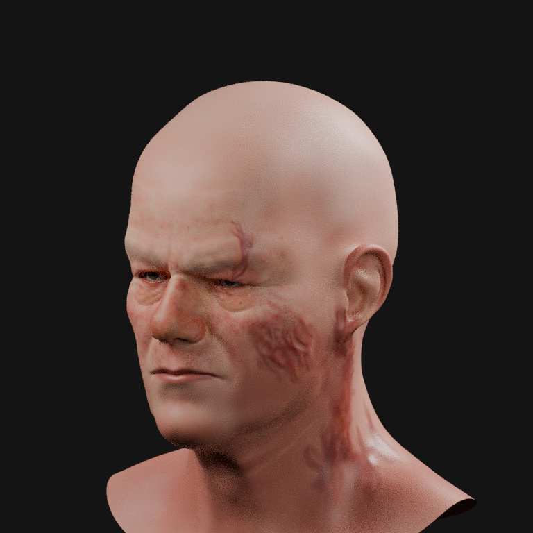

# 一张静态眼睛＋皮肤基础近景

2026-10-23。**唯一近景已完成；眼球与眼睑接合未能证明通过，柏拉图目标也未通过。** 保留原图／源，不平移眼球或补图。结论仅针对当前静态假设、单视角和简化材质，不扩大为完整 Einar 资产失败。

- 从阶段 5 独立 AB `.blend` 重开，已核验其相对默认 EXR 可解析且 SHA 匹配；保留默认雕刻、源 Midlevel／Scale、Catmull-Clark2。
- 三个眼 resize 层均无 driver／Action／NLA、relative Basis、值1，重新提取并按原公式建立新 Mesh；保留 UV／材质分区／crease。每眼 pupil128／iris192／white512 面，使用新近黑／克制棕／暖灰材质。位置严格为已记录的主头 Basis 逆乘 Eye Basis；没有人工偏移。
- 该来源通道候选忽略 Armature 约束／变形及驱动 Shrink/Grow，**不是原 rig neutral 复原**。源库仅读取两个 Mesh；所有来源 ID 被打开干净阶段5源替换，断言无 Armature／Action／Text／Library／Keys 后才求值新场景。
- 皮肤仅 source albedo4k／sRGB／UVMap 和 roughness1k／Non-Color／UVMap，简化 Principled：IOR1.45、Subsurface0。无完整源 shader、未明 Bump、表情、eye atlas／iris-depth／cornea、发须、身体或 Unity。
- 单张768²、16samples、CPU4、AgX exposure0、沿用8／2／6W灯光，关闭 DOF／降噪／合成器。近景画幅收紧为0.36，其余不以滤镜遮掩。
- 成功进程 **12.964s／峰值631.2MiB／exit0**；源 SHA／字节／只读保持，其他进程未终止。两次进程、一次实际渲染：首试在重开校验时把保存的 Render Result 内部 ID 误计为资产图而退出，未渲染；保留失败日志，修正只移除 RENDER_RESULT／COMPOSITING 内部 ID 后完成。不是重出图。
- 初次保存的新源 `.blend` 为1345426字节，三纹理复制到其 `textures/` 并记录 SHA。但提交检查发现 Blender 保存时将路径重映射回旧 A/B 目录，原遮挡回查仅按元数据路径验证文件，没有验证实际 Image filepath，不能据此认定副本可独立。已仅修正新副本的纹理引用，再重开核验实际 Image 路径位于同目录 `textures/`、SHA 匹配；几何／对象变换与唯一PNG保持不变，旧 A/B 未覆盖。见下方打包记录；Unity/runtime 未验证。

B 已实际看图：颜色、斑点／瘢痕样信息及雕刻贡献清楚，但双眼仅窄暗眼裂，无清楚可辨的虹膜／瞳孔／巩膜；无法从该图确认眼睑贴合或排除遮挡／穿插。皮肤有明显原角色伤痕外观，不是柏拉图完成。没有凭单图认定几何根因。

独立检查员已实际查看同图：同意眼部边界不足以可靠检查接合；看到伤痕、颈侧亮部与部分蜡感，整体偏冷峻成年男性，老人松垂大形及柏拉图辨识不足。负责人最终判定本轮人物视觉验收不通过：皮肤／形体恢复有进步，但眼球无法清楚辨认，伤疤红斑不合柏拉图方向。该判断严格限于本原型。

用户要求继续后追加一次只读几何回查，无新渲染或文件保存：4.791s／569.09MiB／exit0。使用本相机正交射线、每个朝相机分区最多64个面中心采样，头部先命中 L pupil46/64／iris38/64、R pupil13/64／iris27/64；巩膜分别57/64／55/64。这证明当前视角有部分头部几何遮挡贡献；不区分眼位／眼睑的责任，不是像素面积加权可见率，也未包含眼自遮挡，不能推出一个可随意平移的修正量。数据见 `stage7-eye-occlusion-diagnostic.json` 与 `stage7occlusion-run.json`。单张近景仍是唯一实际图。

提交前的依赖修正未渲染、未求值依赖图、未开源库：最终重开检查4.45s／511.75MiB／exit0，三张实际 Image 路径／SHA、几何与对象变换、原PNG字节均核验。前两次打包校验分别因 Windows 分隔符严格比较与将 Blender `//textures/file` 当 UNC 路径提取文件名失败；期间另做一次只读实际路径检查，进程exit0。四次进程及日志全部保留为 `stage7package*`，不计作渲染。原保存路径保留在近景元数据，实际结果见 `stage7-package-verification.json`；原遮挡 JSON 作为历史原始输出保留，其路径核验措辞受上述局限约束。

独立源：`art/characters/plato/v002/einar-static-closeup-review/einar-static-rest-skin-closeup.blend`，同行 `SOURCE.md`／三纹理；数值、假设和 SHA 见 `stage7-static-closeup.json`，失败与成功进程分别 `stage7-run.json`／`stage7r1-run.json` 及对应日志。静态准备见 [阶段6](STAGE6.md)。

来源：[Einar Rig (CC-BY) Blender Foundation | studio.blender.org](https://studio.blender.org/characters/einar/v1/)，[CC BY 4.0](https://creativecommons.org/licenses/by/4.0/)。
