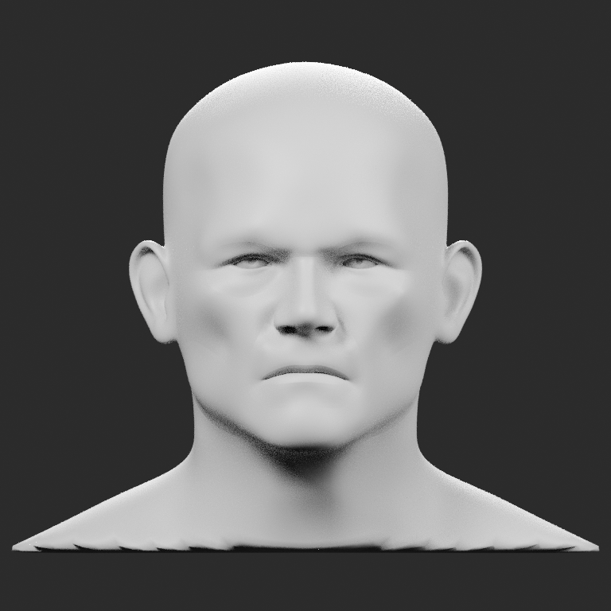
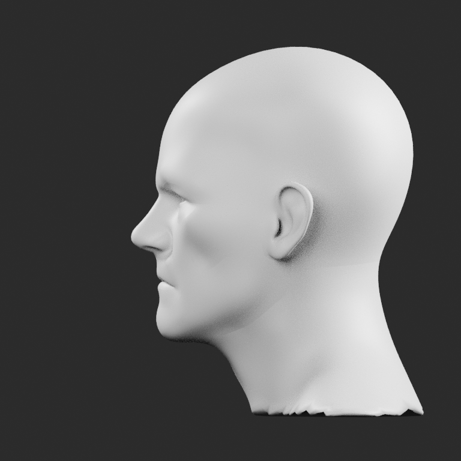
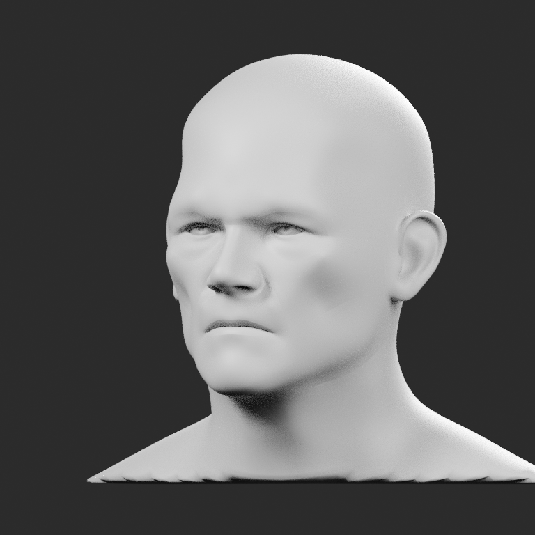

# 无发老年头第一门槛：否决

负责人、B 与独立检查员均已实际查看正、侧、四分之三三张灰模，年龄门槛未通过。颧下凹面和口角下压可见，但整体仍像消瘦、严肃的成年男性；眉眶／上睑覆盖、口周松垂与颊颌组织不足，侧面下颌到颈部仍紧实。颈底新增连续锯齿，是本次形变引入的缺陷。本候选不进入发须制作，不接入 Unity。

本轮仅各渲染一次：768×768、32 samples、无降噪、4 CPU 线程，无 GPU；三次用时分别约 10.11、9.28、9.21 秒，Blender 已退出。相机、跨度、中性灰与照明沿用几何研究的控制条件；正面可与 `../C0_front_licensed_base_control_gray.png` 对比。已有侧／四分之三对照是 C1，小幅形变版而非 C0，不能把它们说成新增的 C0 三视图。本轮没有追加渲染对照。

来源仍为已署名的 Blender Studio / Project Heist 基础头。C0 经一次支持性曲面求值后，用固定眼缘／后脑／颈部地标和解剖目标构成的多调和插值 cage 做宽面形变，保留 Basis 与形体测试两个形状键，未加高斯噪声、皱纹、毛孔、发须、纹理或新身体。它是自动形体假设，不是人工完成的老人雕刻或扫描配准。71 控制点、8.57mm 最大实际位移及零面法线翻转只能说明加工和局部几何状态，**不能证明老年形体、无自交或艺术质量**。零散颈部固定点不足以固定整个截断边界，故出现锯齿；本轮保留失败而不继续调参补图。

单一老年结构参照是[卢浮宫 Ma 921](https://collections.louvre.fr/ark:/53355/cl010279217)，实际查看其同一头像的正面、侧面、四分之三大图；并由[同物 PhotoScan](https://sketchfab.com/3d-models/louvre-pseudo-seneca-photoscan-18ad84ffac884f81bed2aca290b650e2)辅助核对立体关系。官方著录描述老人且保留身份疑问，记录右太阳穴裂缝；石损、表情及短须均不复制。官方照片仅在线阅读，不保存或移植；CC BY 扫描也未下载或用于网格。原画只约束柏拉图角色方向，未投射原脸贴图。

`verification.json` 仅核验真实三张输出、源重新打开、形状键、可见性、4 CPU 限制、三次日志及既有文件保护。27 个 v001 文件、13 个已提交研究／原始 donor 文件，以及 C0／p1／p1b 的源与图哈希保持。本次 `.blend` 在出图前保存，其内部待审元数据反映保存时状态；本报告和 `experiment.json` 记录后来的正式否决。未生成运行 GLB，未修改 main、Unity 或旧候选。

后续决定：停止从该通用年轻头反复自动加参数，转为核验已有老年骨肉形体的来源。当前只收敛 [Blender Studio Einar](https://studio.blender.org/characters/einar/v1/) 一个来源候选，详见 `../../../../../art/characters/plato/v002/source/elder-base-einar-screening.json`：官方免费、CC BY 4.0、实际预览有老年结构，但完整包 553MB 的普通获取检查返回 403，尚未下载或检查本机可提取的头部。**它尚不是“完整可下载且已验证”的可用基底。** 不安装、注册、付费、调用生成 API，后续下载／制作等待负责人对具体来源的核验。
