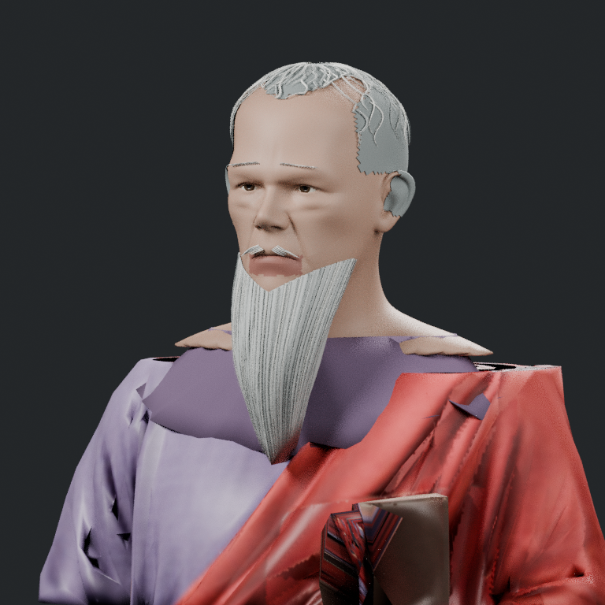

# 柏拉图头肩着色实验：美术未通过

本轮仅渲染一张 768×768 侧前方补图，4 个 CPU 线程、32 samples、无 GPU、无降噪。真实渲染耗时约 24.68 秒，Blender 已退出。负责人复核结论另记于 `portrait.json`；B 与独立检查员均已实际看图并否决美术质量。

本次可确认的改善是头眼显隐错误修复，眼睑、鼻翼和唇线可以辨认。头脸来自已署名的 Blender Studio / Project Heist 基础网格，解剖结构主要继承来源；程序化年龄形体调整不等于完整重雕。新头未投射旧的模糊脸图。

仍然失败的部分：年龄和辨识度偏年轻通用人脸；发壳边缘截齐且有台阶，少量规则白色曲线不足以形成自然头发；胡须虽有连续体块，但呈扁直幕帘，根部与嘴旁硬切，髭须机械；肩部有清楚可见的裁剪破口、裸色盖板和生硬紫色领片。不可称为柏拉图美术完成、头身集成或可替换运行资产。

衣物当前有 93 条边界边、134 条连接超过两个面的边。`static-inspection.json` 按边界连通组记录位置、包围盒、长度与度数；边界数量不等于洞数，自然底部截口／袖口允许保留。本轮否决依据是图中可见的肩领破口与不合理过渡。对全部边界使用 `holes_fill` 可能误封正常开口、产生盖板或不良 UV，不能作为后续“全部封零”的策略。领片外缘仅吸附封口前保留的衣物面，仍未解决实际画面问题。

`portrait-p1` 的隐藏头部失败图、源文件与失败状态保留。`portrait-p1r1` 仅是本地未渲染中间构建，不作为交付或提交文件。p1b 的构建日志先于最终补图；最终源、图、计数以 `portrait.json`、`static-inspection.json`、`render.log` 为准。

`verification.json` 只核验真实源／图、保存路径、重新打开后的显隐、单张日志、27 个 v001 文件和已提交研究文件的哈希保护及许可记录；通过这些检查不能使美术失败变为通过。几何研究原有 18 项检查与本实验独立。源 `.blend` 在渲染前保存，内部待审元数据保留当时状态，当前视觉结论见本报告和 `portrait.json`。

未导出人物运行 GLB，未修改 Unity、v001、main，未增加全身、手、动画或其他人物。本轮补图窗口已用完；后续制作与渲染等待负责人另行分派。
