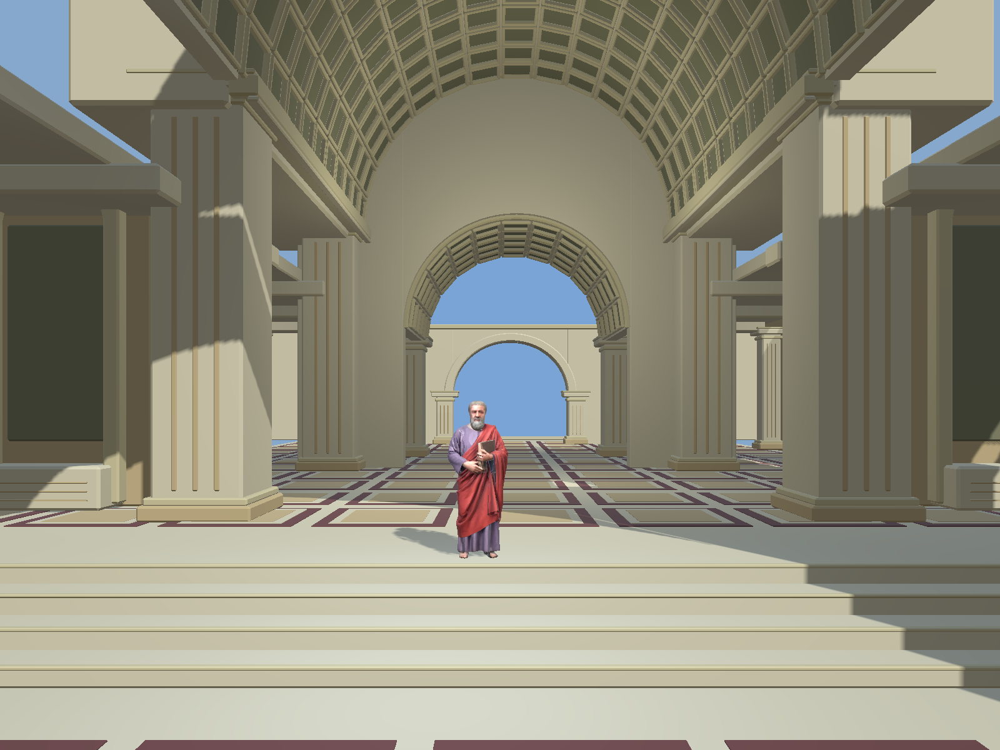
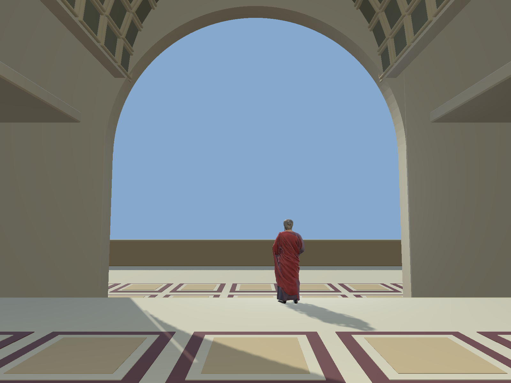
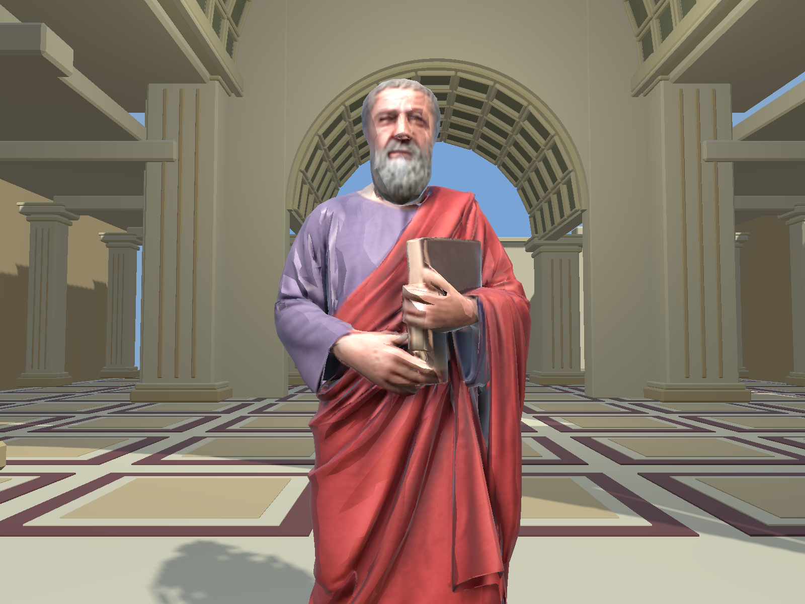
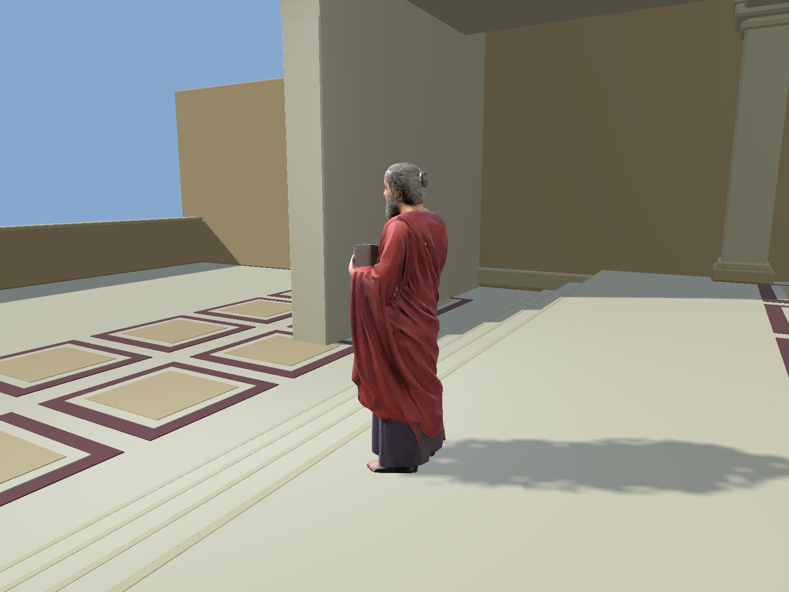
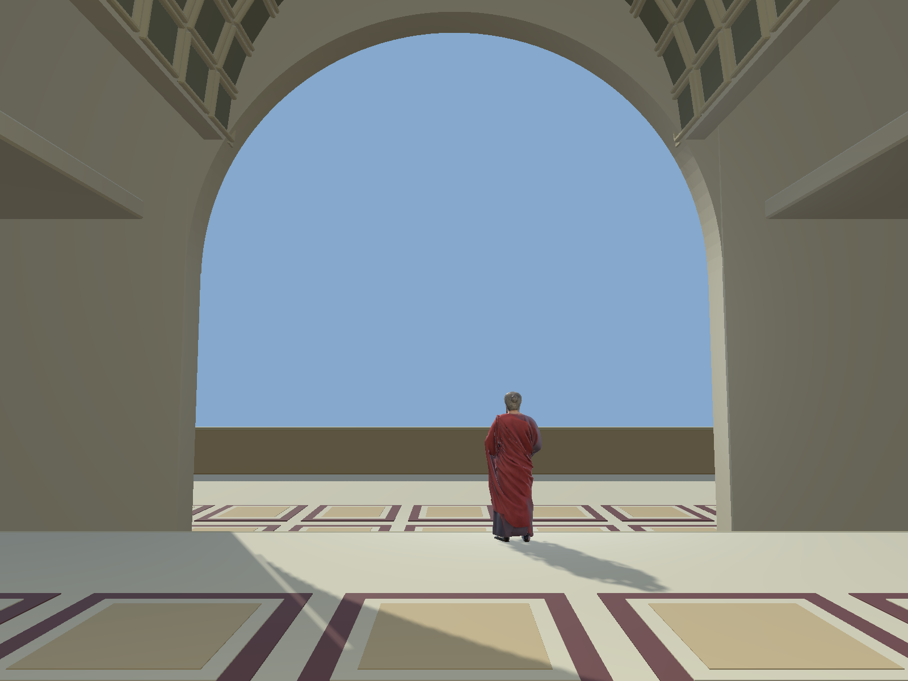

# A-P0 场景交付与自审

状态：**独立 Windows 结构／一人合模样板已构建并通过自动流程；等待负责人最终实物验收。完整美术未通过。**

## 交付入口

- 启动：`../../unity/start-sample.cmd`。
- 程序：`../../unity/Builds/P0/AthensProduction.exe`，必须保留整个同目录构建。
- 可编辑场景：`../../unity/Assets/Scenes/ProductionSample.unity`。
- 参数：`../../art/environment/architecture-parameters.json`。
- 重建：在 production 运行 `./scripts/environment/build.ps1`；复验：`./scripts/environment/verify.ps1`。
- 最新原始证据：[20261022-214215-017](runs/20261022-214215-017/verification.json)。本轮独立证据，不沿用测试版报告。

## 已实现和验证

1. 独立 Unity 6000.0.85f1 / URP 17.0.4 / glTFast 6.20.0 项目、正式产品身份、单一显式入口。没有复制原型 Bootstrap、旧场景或 Library；不启动后端，不连接 8787/8788。
2. 中央 Z 向嵌套拱廊、连续格状拱顶、真实几何倒角、墩柱与线脚、四级登台关系、拼花地面、中段拱肩连接墙、后部门洞墙、入口结构及侧廊屋顶。建筑网格保存为独立 Unity Assets，可通过参数重新生成。柱头和表面仍为结构简化。
3. B 实际诊断版 GLB 的正式导入副本：SHA-256 `121d42a2df197fe860410dd7f99317318e368ebd1d5253fb58245d13c6cc33a4`，7,722,596 字节，28,314 三角形。实际 Renderer 高度1.75m、两张2048²贴图、脚底0.8m平台及材质均通过。导入根为单位变换，不自动归一高度。canonical +Z 的人物仅在场景放置根转向前方访客，没有导入附加180°。
4. 最新构建 Succeeded，**0 errors / 0 warnings**，总输出161,119,184字节。日志：`../../unity/Logs/build-history/20261022-213213-405-build.log`。首轮失败日志仍保留；类型歧义、URP内部类型访问和只读属性调用均已在本次代码中修复。
5. 最新 Player **37/37检查通过、0运行错误**。11个连续路线端点全部通过水平与垂直容差，实际登阶、绕人物、经过平台并下降回地面；端点高度误差约0.025m。连续台阶过渡最大支撑高度差0.22499m，符合0.20m台阶与胶囊皮肤过渡容差。独立侧墙推挤检查也通过。连续路线实际抵达回望位置Z=8：真实眼点(0.00705,2.4750,7.98990)，固定回望机位(0,2.45,8)，距离误差0.02787m；在该位置直接拍摄return-reached.png，再连续走回地面，不以瞬移代替可达性。
6. 保存场景经 AssetDatabase 实际枚举依赖，均位于该独立工程的 Assets/Packages；清单见 `scene-generation.json`。原画照片不在 Assets 或 Player 中。

## 固定原画比较

参考原件1280×1000；在首次构建前固定研究裁切 `[128,128,1024,768]`，对应4:3。外层装饰画框和底部墙板在本阶段未覆盖，不作为已还原部分。主相机始终保持 `(-0.45,2.5,-9)`、垂直FOV50°、归一化地平线Y=0.54；局部修复没有通过移动主机位或改裁切掩盖缺失。

原七个参考UV保持不变；自审发现其未约束近端大拱，因此补充三个近端拱顶锚点。最终测量已从参数坐标改为实际已保存Mesh的内拱顶/起拱顶点、平台前边缘两顶点中点和人物实际Renderer bounds。报告逐点记录来源对象、网格名、顶点索引、局部坐标及世界坐标，参数不再作为实测点来源。总10个投影锚点最大偏差 **2.428%画宽**，平均值及逐点数据见 [composition-comparison.json](runs/20261022-214215-017/composition-comparison.json)。参考点为人工目视标注，约有±8px不确定性；这是投影几何检查，不能等同整体艺术还原率。

对照图仅作本地研究，官方照片再分发使用权未清理。

## 首版反例与有限修复

首版 [hero](runs/20261022-200117-974/hero.png) 和 [return](runs/20261022-200117-974/return.png) 虽有29项技术检查通过，但主图存在露天空洞和悬浮横梁观感，回望缺少建筑围合，不能按画面验收通过。自审和负责人均否决该画面。

本轮修复补入中段拱肩、后门洞墙、入口拱及延伸拱顶、侧廊顶和访客边界；近端起拱高度由5.3m调整为7.15m以贴近原画的高墩柱关系。原主相机与裁切未改。人物近景重设为1.85m观察距离，保持完整头部和持书部位可见，不用于掩盖脸手缺陷。

## 对抗性自审与真实边界

已修正的验收缺口：逐路点补Y高度判断和下降落地门禁；按实际Renderer核对身高；检查导入根变换和实际贴图；增加近端拱顶锚点及真实网格Z序；以实际资产依赖枚举替代独立性声明常量。

**P2已知缺口：远端两侧边界尚未完整围合。** 原侧墙终止于Z=27，平台延伸至Z=30；远端侧向移动存在离开平台／地面的风险。自动中央路线不覆盖该角落，不宣称全场自由漫游边界通过。负责人进行可见窗口审查时要求冻结构建，因此仅记录此问题，未继续重建。访客跌落复位是容错，不能代替边界修复。

其他尚未通过：

- 建筑雕像、浮雕、复杂柱头、穹顶／上部采光结构、完整群像、石材纹理与磨损、烘焙间接光；当前连接墙大面积空白和侧廊接缝仍可见。
- 人物脸、手、书籍接触、衣褶、背面裂隙和指天手势；`art_status` 始终为 `baseline_diagnostic`。A没有改写B人物或把导入称为精修。
- 骨骼、动画、语音、真实LLM；本阶段均未实现。
- A的截图为同一真实Player相机的GPU离屏渲染；不是物理屏幕呈现证据。自动控制器路径没有模拟真实键鼠；临时相机机位不能证明人已走到完全同一观察点。可见窗口与人机输入由负责人另验。
- 约18秒的路线采样观察到约59.52FPS、P95约16.67ms，仅作短时观察，不是3分钟或长期性能验收。

最终两项补证为实际网格锚点与连续抵达回望机位。已按负责人要求完成最后一次重建复验并重新冻结。回望只证明有限灰盒结构与可达性：入口之外仍是未制作的画外空间，**回望完整美术未通过**。

启动脚本将手动日志明确写到 `manual/player-latest.log`，自动运行仍使用独立时间戳目录。

当前结论仅为**中央已验证范围的结构／技术样板可交付审查**。不扩展为完整场景、最终美术或全场漫游已验收。
